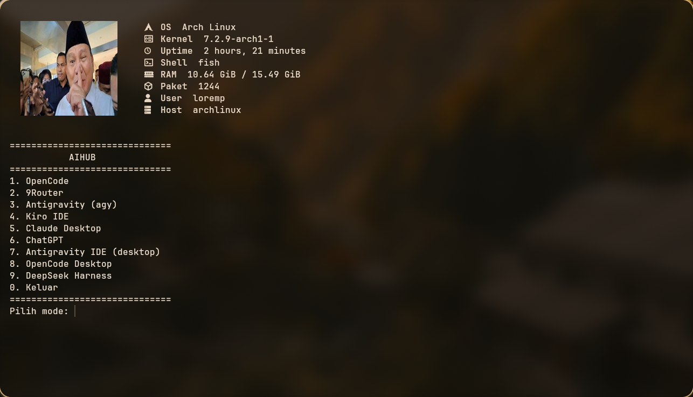

# Hi, I'm Ubyd

  

<i>"aku haesi" — yes, that's my school, and yes, I'm proud of it.</i>

---

## About Me

I'm **Ubaidillah Syifa Ahmad**, but everyone calls me **Ubyd**. I'm a student at **HSI Boarding School**, where my laptop time is limited, so I make every minute of it count.

I like building things with **code**, running **local AI** on my own machine, and wiring up **AI agents** that do the boring work for me, so I can spend my time on the fun work.

I've already built a bunch of projects, and I'm still shipping more.

- **OS:** Arch Linux (with Caelestia), previously Ubuntu. Yes, I use Arch, btw.
- **AI:** local models, AI agents, and automation
- **Code:** Flutter, React, Python, and whatever the project needs
- **Base:** HSI Boarding School, where the Wi-Fi and the laptop hours are both limited

## Skills

| Category | Stack |
| :--- | :--- |
| Mobile | Flutter, Dart, React Native |
| Web | React, Three.js, JavaScript, HTML, CSS (the classics, they never go out of style) |
| Scripting | Python, Bash |
| Backend | Firebase |

## My Terminal

Arch Linux, fish shell, and an `AIHUB` launcher menu so all my AI tools are one number away.

  

## What I'm Into

| Area | What I do |
| :--- | :--- |
| AI Agents | Automate repetitive tasks so I don't have to |
| Local AI | Run models on my own hardware |
| Linux | Customize my setup until it's perfect (then break it and start over) |
| Python | Scripts, tools, and experiments |

## Projects

> Coming soon: I have many, I just need to pick the best ones to show off.

<!-- Replace with your real projects, for example: - [**project-name**](https://github.com/username/project-name): one funny line about what it does -->

## Ask Me About

- Setting up Arch Linux without crying (too much)
- Running AI locally
- Automating things with AI agents
- Surviving boarding school with only a few hours of laptop time

## Fun Facts

- My laptop schedule is stricter than my coding schedule.
- I can rice a desktop faster than I can wake up for the morning schedule.
- If it can be automated, I'll automate it. If it can't, I'll try anyway.

## Contact

| Platform | Link |
| :--- | :--- |
| Instagram | [@syi_ahmmad](https://www.instagram.com/syi_ahmmad/) |
| TikTok | [@loremp993](https://www.tiktok.com/@loremp993) |
| LinkedIn | [Ubaidillah Syifa Ahmad](https://www.linkedin.com/in/ubaidillah-syifa-ahmad-694004372/) |
| Email | [ubedahmmad@gmail.com](mailto:ubedahmmad@gmail.com) |
| Phone | +62 896-4998-2681 |

---

Thanks for stopping by! ⭐ a repo if you like what you see.

